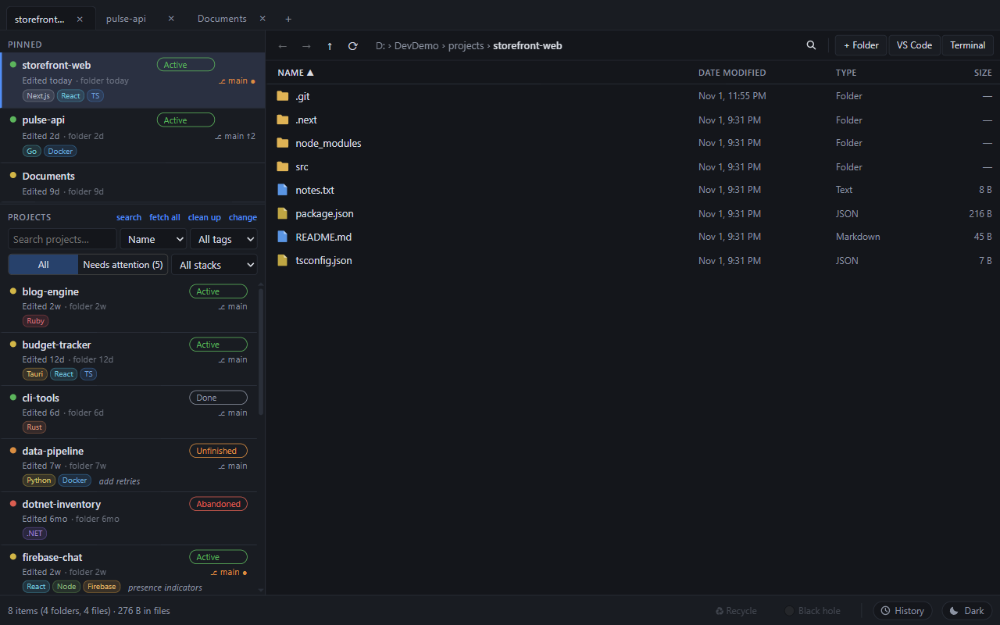
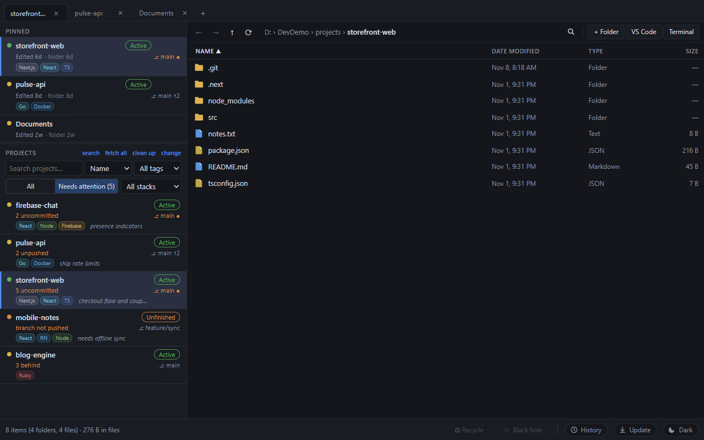
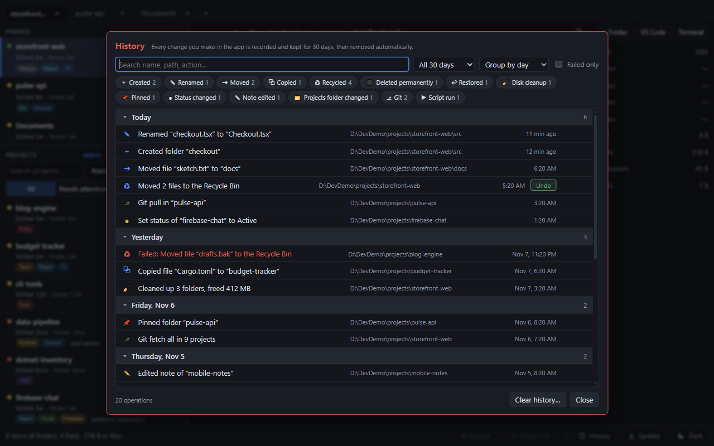
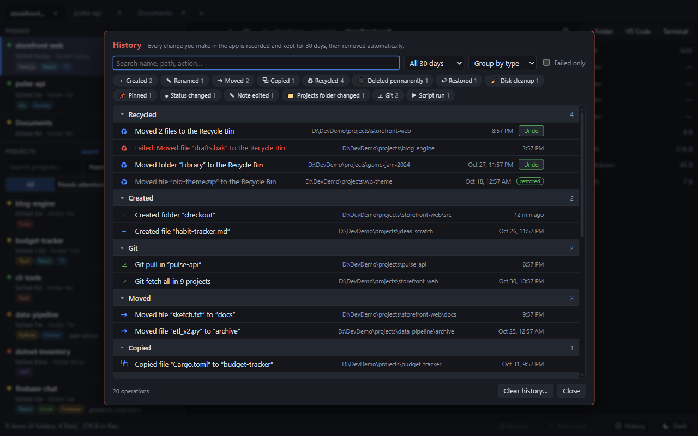
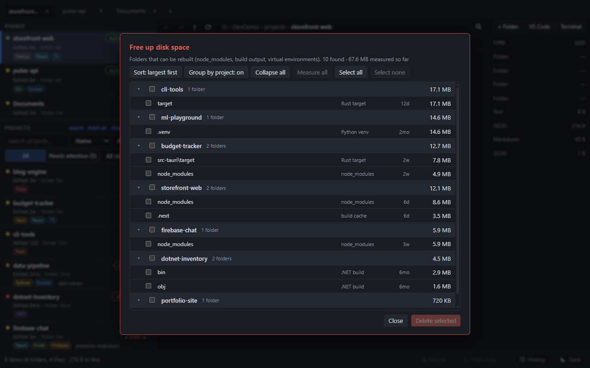
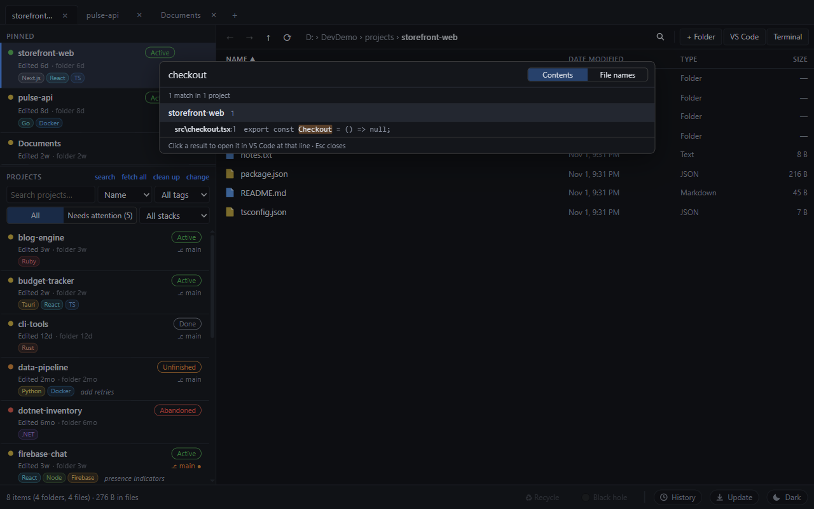
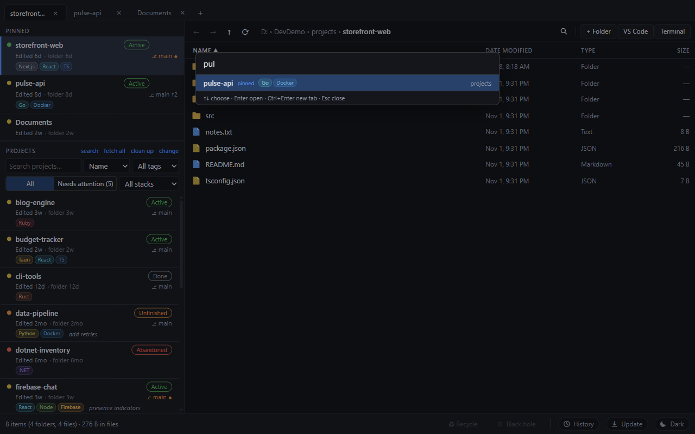
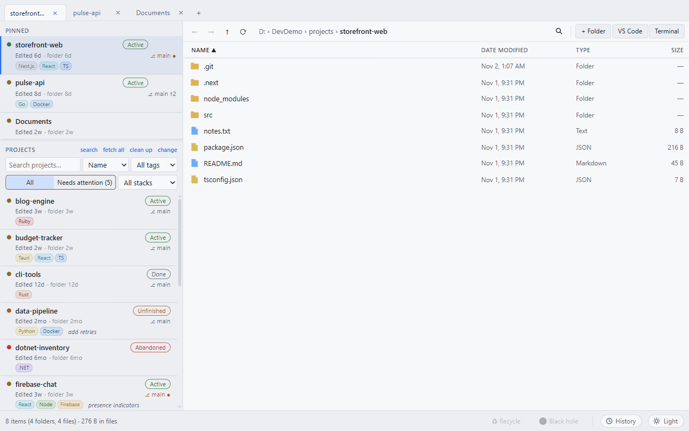

# DevFileExplorer

A fast desktop file explorer built for developers whose projects folder has grown out of control. It shows how stale every project is, what has uncommitted or unpushed work, what you can safely delete to free disk space, and it remembers every change you make for 30 days.

Built with **Tauri 2** (Rust) and **React 19 + TypeScript**. No UI library, no database, no cloud: one small JSON file for settings, nothing leaves your machine.



> **[User guide site](https://suhailaleryani.github.io/DevFileExplorer/)** · **[Download](https://github.com/suhailaleryani/DevFileExplorer/releases/latest)** · **[Request a feature](https://github.com/suhailaleryani/DevFileExplorer/issues/new/choose)**
>
> **Status:** early and in daily use on Windows. macOS and Linux are targeted in the code but not yet verified; see [Platform status](#platform-status). **Contributions and feature requests are very welcome**: see [Contributing](#contributing).

## Contents

- [Install](#install)
- [Quick start](#quick-start)
- [What it does](#what-it-does)
- [Keyboard and mouse](#keyboard-and-mouse)
- [Where your data lives](#where-your-data-lives)
- [Safety](#safety)
- [Testing](#testing)
- [Platform status](#platform-status)
- [Project layout](#project-layout)
- [Roadmap](#roadmap)
- [Contributing](#contributing)
- [License](#license)
- [Publishing the guide site](#publishing-the-guide-site)

## What it does

### Project dashboard

Pick a **projects folder** once. Every direct subfolder becomes a project card in the left pane.

- **Age at a glance**: a coloured dot and "Edited 2w · folder 2w" show how long since a file inside last changed (ignoring `node_modules`, `.git`, `dist`, `target`, `bin`, `obj` and other generated folders) and how long since the folder itself changed. Colours: green under 1 week, yellow under 1 month, orange under 3 months, red older. The ignore list and the thresholds can be changed in the settings file (`ignore` and `thresholds` in `state.json`); there is no settings screen yet.
- **Status tags**: Active, Unfinished, Abandoned, Done, Idea. One click to set.
- **One-line notes** ("what's left to do") on any project.
- **Git info** when `git` is installed (it is found even if it is not on the PATH): current branch, uncommitted changes, commits ahead (unpushed) and behind the remote.
- **Tech stack chips** detected from marker files, for 24 stacks: Tauri, Next.js, React, Vue, Svelte, Angular, React Native, Electron, Flutter, Unity, Unreal, WordPress, Rust, TypeScript, Node, Python, .NET, Java, Go, PHP, Ruby, C++, Docker and Firebase. Monorepo folders (`apps/*`, `packages/*`, `services/*`, `web`, `api`, ...) are looked into too.
- **Search, sort and filter**: search by name; sort by name, folder date, content date or status; filter by status tag and by stack (with counts).
- **Needs attention view**: one click lists only the projects that need a look, with the reasons: uncommitted changes, unpushed commits, a branch that was never pushed, Active or Unfinished projects untouched too long, and commits behind the remote. Repositories with no remote are never flagged as unpushed.
- **Ctrl+K quick jump**: fuzzy-jump to any project or pinned folder. Enter opens it, Ctrl+Enter opens it in a new tab.



### Pinned folders

Pin any folder (context menu, or drag it onto the pinned area). Pins look like project cards (age, status, branch, stack chips), can sit outside the projects folder, and can be reordered by dragging or with Move up / Move down.

### Browsing

- **Tabs** with their own history; open a folder in a new tab with middle-click or the context menu; reorder by dragging; open tabs are restored on the next launch. **Each tab also has its own projects folder and project list**: click **change** in a tab to give just that tab another projects folder, and a new tab starts with the folder of the tab it was opened from.
- **Address bar** you can type into, plus clickable breadcrumbs. Back, forward and up navigation, including the mouse back and forward buttons.
- **Columns**: name, date modified, type, size; click a header to sort. File icons are coloured by type.
- **Folder sizes** are calculated in the background on demand ("calculate"), with a time budget so a huge folder never freezes the window.
- **Filter box** (Ctrl+F) narrows the current folder as you type.
- **Selection**: click, Ctrl+click, Shift+click, **drag-select (marquee)**, Ctrl+A, and arrow, Page Up/Down, Home and End keys. The status bar shows counts and total size of the selection (folders measured recursively).
- **Virtualised lists** everywhere, so folders with 100k entries stay smooth.
- **Themes**: System, Light or Dark, with the native title bar following the choice.
- **Open in** the OS file manager, VS Code (`code` on the PATH) or a terminal at that folder.

### File operations

- **Copy, cut and paste** with Ctrl+C / X / V or the context menu.
- **Drag and drop** to move (or copy with Ctrl/Alt held) between the file list, tabs, pinned folders and projects. Dropping onto a pinned folder or a project asks first: Move, Copy or Pin.
- **Rename** (F2), **New folder** and **New file** (the new item opens for renaming at once). Rename retries briefly when Windows has the folder locked (antivirus, scanners).
- **Name clashes keep both** ("name - copy", "name - copy (2)"); nothing is overwritten silently.
- **Two delete zones** in the status bar, highlighted while you drag:
  - **Recycle** (Delete): moves to the OS trash, recoverable.
  - **Black hole** (Shift+Delete): permanent, in parallel so a huge `node_modules` disappears quickly. Asks for confirmation with the item count and total size; you can switch the question off.
- Read-only and locked files are reported per item; the rest of the operation continues.

### History and undo



Click **History** in the footer. Every operation is recorded, not only file operations:

- created, renamed, moved, copied, recycled and permanently deleted items; restores; disk cleanups;
- pins and unpins, status changes, note edits, changing the projects folder;
- git fetch, pull, branch switches and "fetch all"; scripts you run.

Failures are recorded too, in red, with the error text. Entries are kept for **30 days** and then removed automatically (also from the file). The panel supports **search** (every word must match a name, path, action or error), **filtering** by type, time range and "failed only", and **grouping** by day, type or folder, with collapsible groups. Click a row for the full paths; **Open** jumps to that folder. **Undo** puts recycled items back from the Recycle Bin (it picks the right item when several have the same name and never overwrites). "Clear history" asks first.



### Disk space cleaner



"clean up" in the Projects header finds regenerable folders: `node_modules`, Rust `target` (next to `Cargo.toml`), `dist` (next to `package.json`), `.next`, `.nuxt`, `.svelte-kit`, `.turbo`, `.parcel-cache`, Python virtual environments (with `pyvenv.cfg`), and .NET `bin`/`obj`. Nothing is scanned until you open it; sizes are measured as rows scroll into view or with "Measure all". Group by project, collapse groups, sort by size or project, select all or none, then delete permanently after a second confirmation.

### Git quick actions

Right-click a project or pin for **Git**: fetch, pull (**fast-forward only**, so it can never create a merge commit or conflict), switch branch, and recent commits. **fetch all** in the Projects header fetches every git project three at a time and refreshes the badges. Push is deliberately not included. Git never stops to ask for credentials.

### Run scripts

A play button on cards and pins (or right-click, "Run script...") lists the `package.json` scripts (npm, pnpm, yarn or bun, chosen by the lock file) and `cargo run / build / test / check`, and starts the one you pick in a new terminal window in the project folder. The command is rebuilt from a validated script name, never passed as free text.

### Search across projects



**Ctrl+Shift+F** (or "search" in the header) searches file **contents** or **file names** in every project, three at a time, grouped by project. Click a result to open VS Code at that line; "folder" opens the project in a new tab. It skips `node_modules`, `.git`, ignored folders, binary files and files over 1 MB, and caps results per project.





## Keyboard and mouse

| Keys | Action |
| --- | --- |
| Ctrl+K | Quick jump to a project or pin |
| Ctrl+Shift+F | Search across projects |
| Ctrl+F | Filter the current folder |
| Ctrl+L or Alt+D | Edit the address bar |
| Ctrl+T / Ctrl+W | New tab / close tab |
| Alt+Left / Alt+Right, mouse back / forward | Back / forward |
| Backspace | Up one folder |
| Enter | Open the selected item |
| F2 | Rename |
| F5 | Refresh |
| Ctrl+C / Ctrl+X / Ctrl+V | Copy / cut / paste |
| Delete / Shift+Delete | Recycle / delete permanently |
| Ctrl+A | Select all |
| Arrows, Page Up/Down, Home, End | Move the selection |
| Esc | Close a panel, clear the filter or search |
| Middle-click a folder, breadcrumb or tab | Open in a new tab (tabs: close) |

On macOS the Command key works where Ctrl is listed (not yet verified there).

## Where your data lives

| What | Where |
| --- | --- |
| Settings, pins, tags, notes, tabs | `%APPDATA%\com.fileexplorer.app\state.json` |
| Operation history (30 days) | `%APPDATA%\com.fileexplorer.app\history.json` |
| Portable mode | Put an empty file named `portable.flag` next to the executable; data is then stored next to it (`fileexplorer-data.json`, `history.json`). |

On macOS and Linux the equivalent per-user app-data folder is used. The bundle identifier keeps its original value on purpose so existing data survives the rename to DevFileExplorer. Your project folders are never modified except by operations you trigger.

## Safety

- Permanent deletes ask for confirmation (with size) unless you turn that off; Recycle is the default.
- Pasting or dropping never overwrites: clashes keep both.
- Scripts are launched from names validated against the project's own `package.json` / `Cargo.toml`.
- Git actions never push, never merge on pull, and never prompt for credentials.
- Heavy scans (sizes, search, git) run in the background with time budgets, so the window stays responsive.
- Nothing is uploaded; there is no telemetry.

## Install

### Windows (recommended)

1. Open the [latest release](https://github.com/suhailaleryani/DevFileExplorer/releases/latest) and download one of:
   - **`DevFileExplorer_x.y.z_x64-setup.exe`**: the installer. It installs for your user only (no administrator rights), adds a Start Menu entry and a desktop shortcut, and can be removed from Settings > Apps.
   - **`DevFileExplorer_x.y.z_x64-portable.zip`**: unzip anywhere and run `dev-file-explorer.exe`. It keeps its settings next to the exe, so it can live on a USB stick and leaves nothing behind.
2. Run it. The app is not code-signed yet, so Windows SmartScreen may say "Windows protected your PC": click **More info**, then **Run anyway**.
3. It needs the Microsoft Edge WebView2 runtime, which is already part of Windows 10 (recent) and Windows 11. The installer downloads it automatically if it is missing.

### macOS and Linux

There are no downloadable builds yet and nothing has been verified on these systems (see [Platform status](#platform-status)). You can [build from source](#build-from-source), and testers are very welcome.

### Build from source

Requirements: Node 22 or newer, stable Rust, and on Windows the Visual Studio C++ Build Tools. On Linux, the Tauri system libraries (see `.github/workflows/ci.yml` for the exact package list). Git is optional.

```
git clone https://github.com/suhailaleryani/DevFileExplorer.git
cd DevFileExplorer
npm install
npm run tauri dev                    # run with hot reload; the first build is slow
npm run tauri build                  # make the installer (src-tauri/target/release/bundle)
npm run tauri build -- --no-bundle   # just the executable
```

Saving a `.tsx` or `.css` file hot-reloads. Saving anything in `src-tauri` rebuilds and restarts the app (20 to 40 seconds). If a rebuild fails with "Access is denied" on the executable, the old app is still running: close it and start again.

## Quick start

1. **Choose your projects folder.** On first launch click **change** in the *Projects* header of the left pane and pick the folder that holds your projects (for example `D:\Projects`). Each subfolder becomes a card.
2. **Read the cards.** The coloured dot and "Edited 2w" show how stale a project is; the chips show its stack; the branch shows git state. Click a card to browse it on the right.
3. **Tag and note.** Click the status pill (Active, Unfinished, Abandoned, Done, Idea) and add a one-line note for what is left.
4. **Find what needs you.** Click **Needs attention** to see uncommitted or unpushed work, or press **Ctrl+K** to jump to any project.
5. **Free space.** Click **clean up** to remove `node_modules`, build output and virtual environments you can rebuild.
6. **Look back.** Click **History** in the footer to review, search or undo what you did in the last 30 days.

Everything else (tabs, drag and drop, search across projects, git actions, scripts) is described in [What it does](#what-it-does). The [guide site](docs/index.html) has the same content with screenshots.

## Testing

```
npm test               # JS unit + contract tests, then the Rust tests
npm run test:js        # 49 tests: path/format helpers, attention rules, history logic, command contract
npm run test:rust      # 62 tests: file operations, cleaner, stack detection, scripts, search, git, trash restore
npm run test:smoke     # read-only check of a running dev app (sends no input)
npm run test:ui        # isolated UI regression checks for tabs and per-tab project lists (needs the demo projects and the Vite server, see tests/demo)
npx tsc --noEmit       # type-check; must print nothing
```

- **Unit** (`tests/unit`): pure TypeScript logic, run with Node's built-in test runner, no dependencies.
- **Contract** (`tests/contract`): every command the frontend invokes exists, is registered and uses camelCase arguments; security-relevant config stays as expected.
- **Rust** (`tests/rust/commands.rs`): compiled into the crate for tests only, so private functions are reachable. Every test works in its own throwaway folder under the system temp directory. The recycle-bin test sends one temporary file to the real bin and restores it.
- **Smoke** (`tests/smoke`): process, window, dev server and a non-blank screenshot.
- **Never test on real project folders.** `tests/demo/make-demo.ps1` builds 14 fake projects (different stacks, ages and git states) in `D:\DevDemo`, and `tests/demo/capture.mjs` takes the screenshots in this README from an isolated copy of the app, driven over the DevTools protocol so no mouse or keyboard input is ever sent.
- **CI** (`.github/workflows/ci.yml`) runs type-check, JS and Rust tests on Windows, Ubuntu and macOS for every push and pull request.

There are no automated UI tests for drag and drop, marquee selection or the context menus yet; those are checked by hand.

## Platform status

| | Windows | Linux | macOS |
| --- | --- | --- | --- |
| Developed and used daily | yes | no | no |
| JS tests (49) | pass | pass (Ubuntu in CI and on a local Ubuntu 24.04) | pass (CI) |
| Rust tests (62) | pass (local and CI) | pass (CI, Ubuntu) | pass (CI) |
| Type-check and compile | pass | pass | pass |
| App launched and used by a person | yes | no | no |
| Installer / portable zip in Releases | yes (unsigned) | no | no |

CI results are for the code on `main`; see the Actions tab for the latest run.

### Known gaps on macOS

The code compiles and the automated tests pass on a macOS CI runner, but no person has run the app on a Mac yet. Specifically:

- **No manual testing at all**: layout, fonts, drag and drop (WKWebView handles HTML5 drag differently; the Tauri file-drop handler is deliberately disabled), marquee selection, context menus, tab dragging and the native title-bar theming are unverified.
- **Undo for recycled items does not exist on macOS.** The `trash` crate can move items to the Trash there but cannot list or restore them, so the Undo button reports "not supported".
- **Keyboard**: handlers accept Command as well as Ctrl, but nothing has been tried; macOS conventions (Cmd+Backspace to delete, Return to rename, Cmd+[ and Cmd+] for back and forward) are not implemented.
- **Run scripts is Windows only.** Opening a terminal uses `Terminal.app`; opening VS Code needs the `code` command installed to the PATH.
- **Moving to the Trash** goes through Finder, which may show permission prompts the first time.
- **File system differences**: APFS is case-insensitive by default; case-only renames, "name - copy" detection and path comparisons have only been reasoned about, not tested.
- **Packaging**: no `.app`/`.dmg`, no code signing or notarisation, so Gatekeeper will warn.
- **Hidden-window flags and path helpers** were written Windows-first; the JS path helpers handle both separators, but the Rust side has not run there.
- The Rust unit tests that use the Recycle Bin are compiled out on macOS.

### Known gaps on Linux

- The app compiles and all tests pass on an Ubuntu CI runner, but nobody has launched the window on Linux yet. Building needs `libwebkit2gtk-4.1-dev`, `libsoup-3.0-dev` and friends (installed automatically in CI).
- **Run scripts and "Terminal" are not implemented** (no portable way to pick a terminal emulator); they report "not supported".
- Trash behaviour depends on the desktop environment (freedesktop trash). Undo passes its automated round trip on the Ubuntu runner but is untested on real desktops.
- Wayland versus X11, high-DPI scaling and dark-mode detection are untested.

### Can it be tested on Linux?

Yes, three ways:

1. **CI (recommended).** Push to GitHub: the workflow builds and tests on Ubuntu and macOS runners as well as Windows, with no local setup. This is the only practical way to cover macOS without a Mac.
2. **WSL2 on Windows.** Install the system libraries once, then run the same commands:
   ```
   sudo apt install libwebkit2gtk-4.1-dev libsoup-3.0-dev librsvg2-dev libayatana-appindicator3-dev libxdo-dev libssl-dev build-essential
   curl https://sh.rustup.rs -sSf | sh
   npm install && npm test
   ```
   Windows 11 with WSLg can even show the app window (`npm run tauri dev`).
3. **A Linux machine or VM.** Same commands.

## Project layout

| Path | What it holds |
| --- | --- |
| `src/App.tsx` | App state, shortcuts, tabs, selection, drag and drop, git and script handlers, history logging |
| `src/Sidebar.tsx`, `src/attention.ts`, `src/stacks.ts` | Project dashboard, pins, filters, attention rules, stack labels |
| `src/historyLog.ts`, `src/historyStore.ts`, `src/History.tsx` | History logic (pure), shared store and saving, the panel |
| `src/Cleaner.tsx`, `src/Search.tsx`, `src/QuickJump.tsx` | Disk cleaner, cross-project search and commits viewer, Ctrl+K |
| `src/components.tsx`, `src/FileList.tsx` | Virtual list, tabs, status bar, menus, file table |
| `src/api.ts`, `src/util.ts` | Typed `invoke` wrappers; path, size and date helpers |
| `src-tauri/src/lib.rs` | All Rust commands |
| `tests/` | `unit`, `contract`, `rust`, `smoke`, `demo` |
| `docs/` | Guide site (`index.html`) and screenshots, ready for GitHub Pages |

`src/App.css` holds all styling; new rules go at the end of the file because later rules win.

## Roadmap

Ideas, in no particular order. Open an issue to vote or add one.

- File preview pane (Space), running dev servers and ports, clone from URL
- TODO/FIXME counts, `.env` safety warnings, dependency health (`npm outdated`, `cargo audit`)
- Choose the editor (not just VS Code), archive a stale project
- A settings screen (ignore list, age thresholds, confirmation prompts)
- Live file watching instead of refresh on focus
- Progress indicator and cancel for long copy and move operations
- Replace / skip prompt on name clashes (today both are kept)
- Keyboard control of context menus; Close tab / Close others on tabs
- Cache project dates between launches
- Terminal and scripts on macOS and Linux; Undo on macOS
- Installer and portable packaging; macOS and Linux verification

## Contributing

**Developers are invited to contribute, and to ask for features.** DevFileExplorer is MIT licensed and every kind of help counts: ideas, bug reports, docs, tests, code.

- **Want a feature?** [Open a feature request](https://github.com/suhailaleryani/DevFileExplorer/issues/new?template=feature_request.md) and describe the problem you are trying to solve. Small, focused ideas get built fastest.
- **Found a bug?** [Report it](https://github.com/suhailaleryani/DevFileExplorer/issues/new?template=bug_report.md). The History panel shows failed operations with their error text.
- **Want to help test?** The most valuable thing right now is **running the app and the tests on macOS and Linux and reporting what breaks**.

**To send a code change:**

1. **Fork** the repository on GitHub and clone your fork.
2. Create a branch: `git switch -c feat/my-change`.
3. `npm install`, then `npm run tauri dev`. Experiment on fake projects (`powershell -File tests/demo/make-demo.ps1`), never on real folders.
4. Make the change and **add a test** for it (`tests/unit` for TypeScript logic, `tests/rust/commands.rs` for backend).
5. Run `npx tsc --noEmit` (prints nothing when clean) and `npm test`.
6. Commit with a focused message such as `feat(history): ...` or `fix(search): ...`, push your branch and open a **pull request**. Include a screenshot for UI changes. CI runs the tests on Windows, Ubuntu and macOS.

Full details, the code map and a list of good first contributions are in [CONTRIBUTING.md](CONTRIBUTING.md). Not sure where to start? Open an issue and ask.

## License

[MIT](LICENSE). By contributing you agree that your contribution is released under the same license.

## Publishing the guide site

The `docs/` folder is a static site (a user guide with the screenshots above), published at https://suhailaleryani.github.io/DevFileExplorer/ by `.github/workflows/pages.yml` whenever `docs/` changes on `main`. How it is set up, and how to publish your own copy, is in [docs/publish-guide.md](docs/publish-guide.md).
